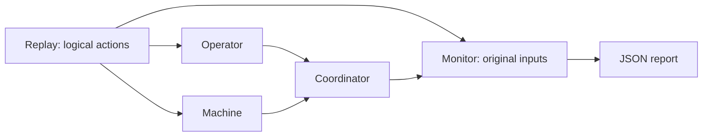

# Manufacturing replay with Lingua Franca

A small, executable model of an operator loading a part, machine observations
arriving, and the operator unloading it. The first experiment asks:

**Can a delayed unload for session A accidentally clear the newer session B?**

The correct coordinator preserves B. An intentionally defective coordinator
clears it, and a separate monitor reports the input prefix and logical tag that
demonstrate the violation.

This is a synthetic, local experiment inspired by Foundation Industries'
milling-tracking contracts. It does not connect to Foundation services or machine
controllers. Its durations are model outputs, not measured machining time.

## Run on your Mac

The existing `.venv` has LF 0.13.0 and Python 3.12. Native compilation also needs
CMake, a C compiler, and Python development headers. From this repository:

```sh
.venv/bin/python scripts/replay.py build
.venv/bin/python scripts/replay.py run
```

The second command saves `artifacts/report.json`. To reproduce the stale-session
counterexample:

```sh
.venv/bin/python scripts/replay.py run scenarios/stale-unload.json --mutant stale-unload --report artifacts/stale-unload-bug.json
```

That command **should exit 1** and report `SESSION_OWNERSHIP` at `late-unload-A`.
Run it again without `--mutant` to see the correct behavior. Exit codes are 0 for
passing contracts, 1 for a completed replay with violations, and 2 for invalid
input, compilation, or runtime errors. The runner requires a successful build
receipt matching the current LF source and removes an old report before starting
a new native run.

Your existing VS Code build task still compiles and runs `src/Main.lf`; with no
environment overrides it uses `scenarios/normal.json`. The native executable
prints the contract result, but its process status alone does not encode a
contract violation. Use the Python runner for automation and exit-code checks.

## Model and contracts



`src/Main.lf` owns scheduling and communication. `replay/coordinator.py` contains
the system under test. `replay/monitor.py` derives its expectations from the raw
input stream and never calls the coordinator or reads its internal state. Sources
and the monitor meet through explicit LF dependencies; Python does not schedule
events with sleeps or threads.

The monitor checks these contracts at each decision:

| Contract | Requirement |
| --- | --- |
| `SESSION_OWNERSHIP` | Only a matching unload may close the current session; attribution cannot use observations captured before its load. |
| `DUPLICATE_IDEMPOTENCE` | A duplicate command or observation adds no execution time. |
| `PROGRAM_MATCH` | Both credited endpoints match the assigned program, ignoring case and a trailing `.NC`. |
| `COVERAGE_CONTINUITY` | Credit needs consecutive sequences, increasing source time, fresh observations, bounded receipt spacing, and one adapter epoch. Gaps and restarts clear the anchor. |
| `EXECUTION_EVIDENCE` | Both credited endpoints are available and `RUNNING`. |
| `ACCOUNTING` | Session totals conserve attributed credit. |

Additional checks cover ingress order, LF delivery tags, decision identity,
complete replay, and manually specified final totals and assignment. Those final
oracles also catch missing credit; a system that never credits anything cannot
pass the positive scenarios.

### Timing and observation policy

Each event has `source_ms` and `receive_ms` relative to one synthetic origin.
Delivery order must be nondecreasing in `receive_ms`; source order may differ.
Source timestamps remain unchanged when delivery is delayed. This version assumes
`0 <= source_ms <= receive_ms` and limits scenarios to 24 simulated hours.

Replay schedules one LF logical action per input. An input at 10 ms is delivered
at elapsed LF logical time 10,000,000 ns. Tied delivery times follow file order at
successive microsteps. This is an explicit ingress arbitration policy: these
events are **not modeled as simultaneous at the same tag**. Different tie orders
are different scenarios. Reports record actual runtime tags, not reconstructed
timestamps.

Execution credit is a deliberately conservative **receipt-time interval** between
two qualifying samples. For example, qualifying observations at 10 and 20 ms add
10 ms. Both source ages and the receipt interval must be within `max_gap_ms`.
Consecutive source sequence numbers are required because this simplified stream
contains one observation channel. No time is extrapolated after the last sample,
across a load/unload boundary, or through missing evidence. Uncredited intervals
are not classified as downtime; raw inputs preserve whether the cause was a hold,
another program, unavailable state, or uncertain coverage. This policy is not an
MTConnect ingestion algorithm.

Samples are deduplicated by `(instance, sequence)`, commands by `id`. The first
observation of a new adapter instance retires the previous instance and starts a
new anchor; retired-instance messages cannot reactivate it. An explicit restart
also clears continuity. Sessions and deduplication history last for one replay.
The restart scenario models an **adapter epoch transition**, not operating-system
process restart or durable recovery. Production clock skew, multiple data-item
streams, persistence, and physical-event truth require separate work.

The target uses `fast: true`, so simulated time can advance faster than wall time.
These experiments establish logical behavior only. LF deadline handlers,
watchdogs, network lateness, and distributed scheduling need separate physical-time
experiments. See LF's [actions](https://www.lf-lang.org/docs/writing-reactors/actions/),
[logical time](https://www.lf-lang.org/docs/writing-reactors/time-and-timers/), and
[deadline semantics](https://www.lf-lang.org/blog/deadlines/).

## Scenarios and fault experiments

| File in `scenarios/` | Perturbation or boundary | Expected execution credit |
| --- | --- | --- |
| `normal.json` | Run, hold, resume, unload | A: 20 ms |
| `stale-unload.json` | A's delayed unload arrives after B loads | A: 0, B: 10 ms; B stays loaded |
| `duplicate.json` | An already credited observation is delivered again | A: 20 ms |
| `wrong-program.json` | Running telemetry initially names another program | A: 10 ms |
| `gap.json` | Explicit unknown-coverage boundary | A: 20 ms |
| `restart.json` | New adapter epoch, then a delayed old-epoch observation | A: 30 ms |
| `stale-restart.json` | Delayed restart message from the retired epoch | A: 20 ms |
| `reordered.json` | Sequence 3 arrives before sequence 2 | A: 10 ms |
| `delayed.json` | An observation is too old on arrival | A: 20 ms |
| `same-time.json` | Ordered microsteps at load/unload boundaries | A: 10, B: 10 ms |
| `coverage-boundary.json` | Spacing exactly at/above the bound; unavailable sample | A: 39 ms |
| `load-boundary.json` | First observation was captured before the load | A: 10 ms |
| `conflicting-load.json` | Another load is attempted during A's session | A: 20 ms |

Fixtures inject delivery and observation faults. Separately, `--mutant` injects
one intentional implementation defect: `stale-unload`, `duplicate-credit`,
`wrong-program`, or `bridge-gap`. The verification command requires the relevant
named contract to catch each defect. A failed mutant run is expected evidence,
not a passing production implementation.

To add an experiment, copy a scenario, edit its delivery stream, and independently
specify `expected_totals_ms` and `expected_active_session`. Do not regenerate the
oracle from the coordinator's output. Use a new command ID for a stale operator
confirmation; replaying the exact original ID exercises command deduplication
instead of the session-identity guard. Tests cover both paths.

## Verify

```sh
.venv/bin/python scripts/replay.py verify --repeats 3
.venv/bin/python -m unittest discover -s tests -v
```

`verify` rebuilds the LF executable, runs every scenario three times with worker
counts 1, 4, and 1, and compares the full semantic reports including logical tags.
It then checks all four mutants. Reports go under `artifacts/verify/`. Unit and
CLI checks cover malformed input, conflicting loads, pre-load observations,
retired adapters, monitor corruption, incomplete replay, and failure exit codes.

Each report contains original inputs, LF tags, decisions, violations, final
totals, source/scenario hashes, and (when run through the runner) the compiler
receipt. A counterexample is the full input prefix through the first violation;
it is not automatically minimized. Reports omit wall-clock timing and worker
execution order so semantic equality is meaningful across runs. Finite replay
tests do not prove the contracts for all possible streams.

## Next experiments

The useful next contribution is to reduce a counterexample to its essential
events and compare the assumptions required by an existing upstream industrial
example. The industrial report explicitly discusses deterministic regression
testing in [section 9.1.1](https://arxiv.org/html/2504.04224v1#S9.SS1.SSS1).
Observed traces could later suggest candidate contracts, with explicit review
and held-out fault scenarios before accepting them. No contract inference or
changes to LF runtime semantics are implemented here.
